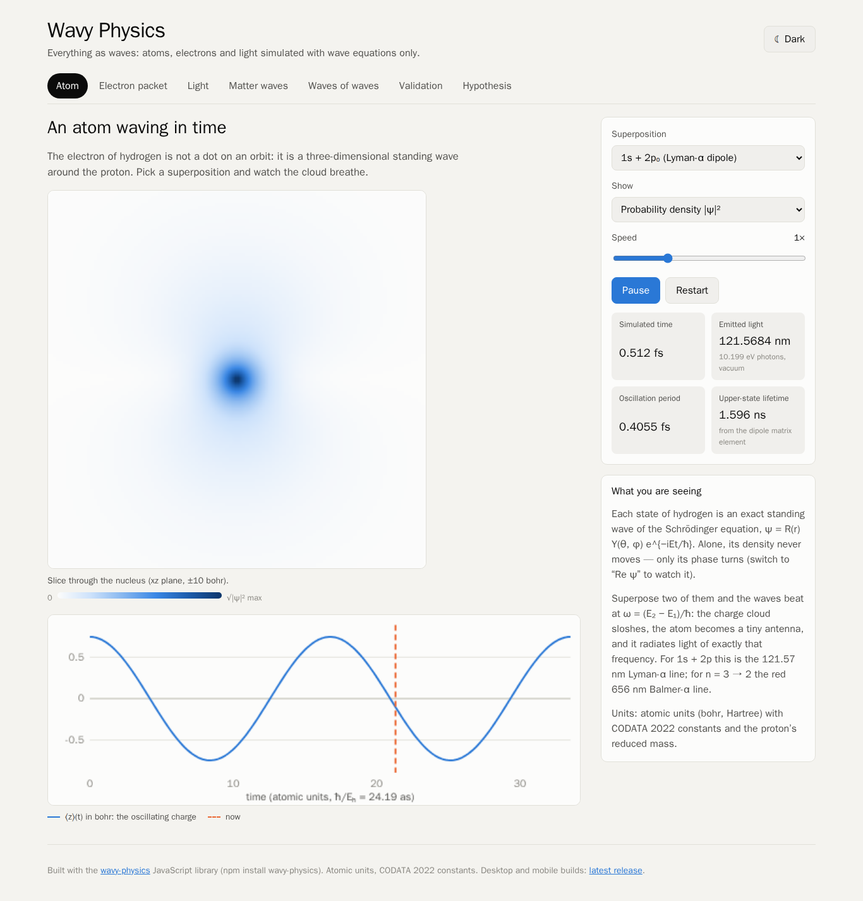
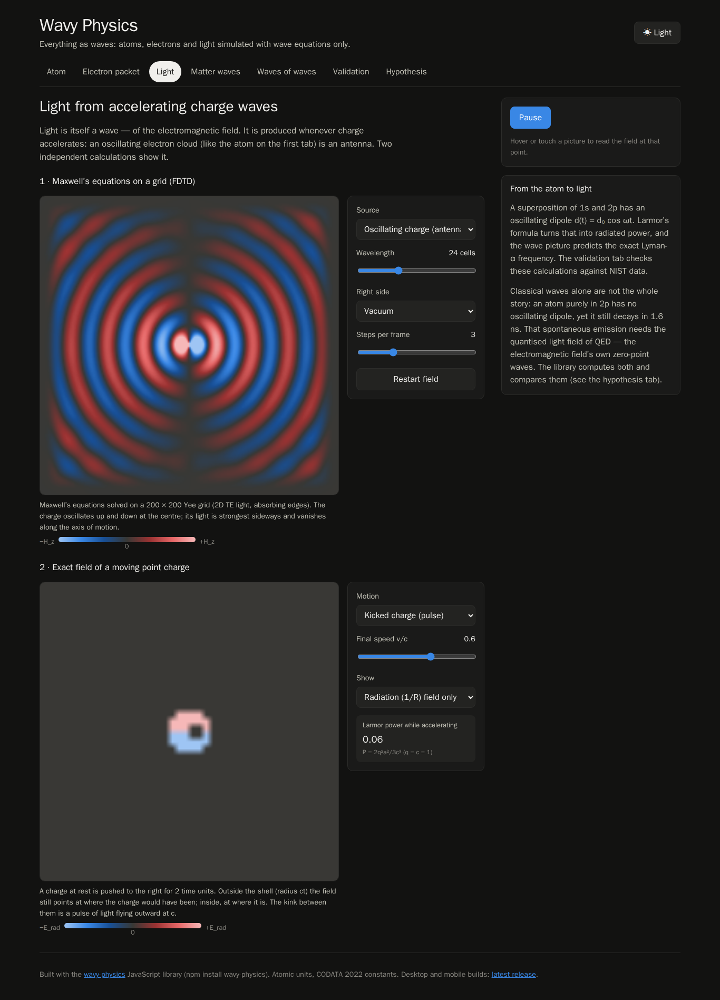

# wavy-physics

**Everything is a wave.** A JavaScript library and an interactive website that
simulate atoms, electrons and light using wave equations only, and that check
every result against measured data (NIST, CODATA 2022) or exact solutions.

- **Website:** <https://konard.github.io/wavy-physics/> (works on phones,
  tablets and desktops, in light and dark themes)
- **Library:** `npm install wavy-physics` for Node.js, Bun, Deno and browsers
- **Background:** [case study for issue 1](docs/case-studies/issue-1/README.md)

| An atom waving in time                                    | Light from an accelerating charge                          |
| --------------------------------------------------------- | ---------------------------------------------------------- |
|  |  |

## Features

- **The atom as standing waves**: exact hydrogen eigenfunctions (reduced mass,
  CODATA 2022) and their time-dependent superpositions. A 1s + 2p charge cloud
  oscillates at the Lyman-α frequency and radiates. Dipole matrix elements,
  Einstein A coefficients and lifetimes (2p: 1.596 ns) come from wave overlap
  integrals. Dirac levels give the fine structure.
- **The electron as a wave packet around the atom**: circular Rydberg packets
  orbit the proton at the classical Kepler period, spread, and revive.
- **Light from accelerating charge waves**: Maxwell's equations on a Yee grid
  (FDTD) with dipole sources and dielectrics, the exact Liénard–Wiechert field
  of a moving point charge, and Larmor and Liénard power. Semiclassical and
  quantum (QED) emission rates are compared.
- **Matter waves**: split-operator Fourier solvers for the Schrödinger equation
  in 1D and 2D (real and imaginary time), tunnelling, the harmonic oscillator,
  the radial wave equation, Dirac Zitterbewegung and nonlinear Schrödinger
  solitons (particle-like waves that survive collisions).
- **Waves of waves**: Fourier synthesis, the Gibbs overshoot and the
  Weierstrass fractal wave with its box-counting dimension.
- **Validation**: 30 benchmarks, run by the test suite on Node.js, Bun and
  Deno, by `npx wavy-physics validate`, and live on the website.

## Quick Start

```bash
npm install wavy-physics
npx wavy-physics validate        # run all 30 benchmarks
npx wavy-physics spectrum 2 1    # Lyman-α wavelength in nm
npx wavy-physics lifetime 2 1    # 2p radiative lifetime in s
```

```js
import {
  HydrogenSuperposition,
  circularWavePacket,
  keplerPeriod,
  runValidation,
} from 'wavy-physics';

// 1s + 2p₀: an atom whose charge cloud oscillates in time.
const atom = new HydrogenSuperposition([
  { n: 1, l: 0, m: 0 },
  { n: 2, l: 1, m: 0 },
]);
atom.expectationPosition(4); // [0, 0, ⟨z⟩(t)] in bohr
atom.createPlaneSampler({ plane: 'xz', extent: 10 }).density(4); // |ψ|² image

// An electron wave packet orbiting the nucleus.
const packet = circularWavePacket({ nMean: 30, width: 1, count: 5 });
packet.expectationPosition(keplerPeriod(30) / 4);

runValidation().every((result) => result.pass); // true
```

Units are Hartree atomic units (bohr, hartree, ħ = mₑ = e = 1). Conversion
helpers and the `SI` / `AU` constants are exported. See
[examples/basic-usage.js](examples/basic-usage.js) for a runnable tour and
[src/index.d.ts](src/index.d.ts) for the full typed API.

### Development

```bash
# Install dependencies
npm install

# Run tests
npm test
bun test --timeout 30000
deno test -A --parallel

# Lint, format and duplication checks
npm run check

# Build and preview the website (also used for desktop and mobile)
npm install --prefix examples/universal-app
npm run example:web:dev
npm run example:web:build
npm run example:desktop:package

# Try the CLI locally
node bin/wavy-physics.js validate
```

## Project Structure

```
.
├── bin/wavy-physics.js   # CLI (validate, energy, spectrum, lifetime, constants)
├── docs/case-studies/    # Research notes, including issue 1 (the hypothesis)
├── docs/screenshots/     # Website screenshots
├── examples/
│   ├── basic-usage.js    # Library tour
│   └── universal-app/    # The website: React + GitHub Pages + Electron + Capacitor
├── experiments/          # Convergence and performance experiments
├── scripts/              # Build, release and CI scripts
├── src/
│   ├── index.js          # Public API
│   ├── index.d.ts        # TypeScript definitions
│   └── physics/          # Wave solvers and the validation suite
└── tests/                # Physics and tooling tests (test-anywhere)
```

## Design Choices

### Waves only

Every simulation evolves a wave equation (Schrödinger, Dirac, Maxwell,
nonlinear Schrödinger, the classical string) or evaluates an exact wave
solution. Particles appear as wave packets or as stable wave configurations
(solitons); there are no point-particle trajectories in the solvers. The one
exception is the Liénard–Wiechert field, which is the exact retarded solution
of Maxwell's equations for a prescribed moving charge. It is used to show how
acceleration produces light.

### Accuracy

Numerical methods are chosen for known error behaviour: split-operator Fourier
steps keep the norm exact with second-order time error, imaginary-time
relaxation finds ground states without analytic input, and FDTD runs at a
stable Courant number. Each benchmark's tolerance reflects the method's error
at its grid size, and the reference value cites its source.

### Multi-Runtime Support

The library has no dependencies and runs on Node.js, Bun, Deno and in
browsers. The [test-anywhere](https://github.com/link-foundation/test-anywhere)
framework runs the same tests on every runtime.

### Universal App Example

`examples/universal-app` is the Wavy Physics website. It is a Vite React app
that imports the library from `src/index.js`, so every frame on screen comes
from the tested solvers. The same static build is used by:

- GitHub Pages (`npm run example:web:build`)
- Electron desktop packaging (`npm run example:desktop:package`)
- Capacitor Android/iOS sync (`npm run example:mobile:sync`)

The app has its own `package.json` and lockfile, so the library itself stays
dependency-free. See
[examples/universal-app/README.md](examples/universal-app/README.md) for
local web, desktop, Android, and iOS testing instructions.

### Code Quality

- **ESLint**: Configured with recommended rules + Prettier integration
- **Prettier**: Consistent code formatting
- **Husky + lint-staged**: Pre-commit hooks ensure code quality
- **File size limit**: Files must stay under 1500 lines for maintainability (enforced via ESLint and CI)

### Release Workflow

The release workflow uses [Changesets](https://github.com/changesets/changesets) for version management:

1. **Creating a changeset**: Run `bun run changeset` to document changes
2. **PR validation**: CI checks for valid changeset in each PR
3. **Automated versioning**: Merging to `main` triggers version bump
4. **npm publishing**: Automated via OIDC trusted publishing (no tokens needed)
5. **Optional Docker Hub publishing**: When configured, waits for the exact npm version and tags the Docker image with that version
6. **GitHub releases**: Auto-created with formatted release notes

> **First release of a brand-new package**: OIDC trusted publishing cannot
> create a package that does not exist yet (the first publish fails with
> `E404`, because a trusted publisher can only be configured for an existing
> package). To bootstrap, add a repository secret named `NPM_TOKEN` (a
> granular/automation token with publish access). The release workflow passes
> it as `NODE_AUTH_TOKEN` automatically. Once the package exists and OIDC
> trusted publishing is configured on npmjs.com, the token becomes optional and
> can be removed.

#### Manual Releases

Two manual release modes are available via GitHub Actions:

- **Instant release**: Immediately bump version and publish
- **Changeset PR**: Create a PR with changeset for review

### CI/CD Pipeline

The GitHub Actions workflow (`.github/workflows/release.yml`) implements a fast-fail pipeline:

**Fast checks** (~7-30s each, run first for fastest feedback):

1. **Test compilation**: Syntax-checks all `.mjs` files with `node --check`
2. **Lint, format & secrets scan**: ESLint, Prettier, jscpd, and [secretlint](https://github.com/secretlint/secretlint) for credential leak detection
3. **File line limits**: Enforces the 1500-line limit on JavaScript (`.js`, `.mjs`, `.cjs`) and Markdown (`.md`) files plus `release.yml`
4. **Changeset check**: Validates PR has exactly one changeset (added by that PR)
5. **Version check**: Blocks manual version changes in `package.json`
6. **Documentation validation**: Checks required doc files (doc line limits are enforced by the file line limits check)

**Slow checks** (only run after all fast checks pass):

7. **Test matrix**: 3 runtimes × 3 OS = 9 test combinations
8. **Broken link checks**: Validates all links in Markdown/HTML files (separate workflow)

**Release** (on merge to main):

9. **Changeset merge**: Combines multiple pending changesets at release time
10. **Release**: Automated versioning and npm publishing
11. **Optional Docker publish**: Publishes Docker Hub `latest` and npm-version tags after the npm package is visible

#### Reasonable Timeouts

Every CI job declares an explicit `timeout-minutes` so hung steps fail
in minutes instead of reaching the GitHub Actions default of six hours.
Fast checks use 5-10 minute caps, release jobs use 50 minutes, and the
link checker uses 10 minutes for external network variance.

That cap is a backstop, never the deadline: GitHub reports a job it
kills as **cancelled**, not **failed**. Long steps therefore own an
explicit budget via `scripts/run-with-budget-warning.sh`, which warns at
70% of the budget and fails the step with exit code 124 when it expires.
See [CI-TIMEOUT-BUDGETS.md](docs/CI-TIMEOUT-BUDGETS.md).

Individual tests are also capped inside supported runners:
`npm test` runs `node --test --test-timeout=30000`, and the CI Bun
runner uses `bun test --timeout 30000`. Both bound a _single test_, not
the suite, which is why the suite budget above exists. Deno does not
provide a single global per-test timeout flag, so Deno tests are
protected by their step budget and the matrix job backstop.

See [BEST-PRACTICES.md](docs/BEST-PRACTICES.md) for detailed explanations of each practice.

#### Robust Changeset Handling

The CI/CD pipeline is designed to handle concurrent PRs gracefully:

- **PR Validation**: Only validates changesets **added by the current PR**, not pre-existing ones from other merged PRs. This prevents false failures when multiple PRs merge before a release cycle completes.

- **Release-time Merging**: If multiple changesets exist when releasing, they are automatically merged into a single changeset with:
  - The highest version bump type (major > minor > patch)
  - All descriptions preserved in chronological order

This design decouples PR validation from the need to pull changes from the default branch, reducing conflicts and ensuring that even if CI/CD fails, all unpublished changesets will still get published when the error is resolved.

### Deploying the example app

The `example-app.yml` workflow deploys the universal example app to GitHub
Pages on every push to `main`. Before the first run on `main` in a new
repository created from this template, open **Settings → Pages** and set
**Source = GitHub Actions**. This is a one-time manual step and cannot be
configured from a workflow because the Pages source defaults to
_Deploy from a branch_. Without it, the `pages-deploy` job fails on
`actions/deploy-pages` with `Get Pages site failed` /
`Failed to create deployment`. After flipping the source, the workflow
provisions the Pages site on its first run.

### Auto-regenerated preview screenshots

The same `example-app.yml` workflow contains a `preview-regen` job that boots
the built example app in a headless Chromium via
[`browser-commander`](https://www.npmjs.com/package/browser-commander) +
Playwright and writes fresh screenshots to
`docs/screenshots/example-app/example-app-{locale}-{theme}.png` on every
push to `main` (and on `workflow_dispatch`). Any drift is committed back to
`main` so README/site images never go stale between releases. Screenshot-only
pushes do not match this workflow's path filter, while a protected-branch
fallback PR remains eligible for its required checks. The job runs in the
official Playwright container with the browser already installed, avoiding CI
stalls from live Chromium downloads.

The same script is available locally:

```bash
npm install --prefix examples/universal-app
npm run example:web:preview-images
# Verbose probe of <html data-theme>, <html lang>, and PNG signatures:
PREVIEW_VERBOSE=1 npm run example:web:preview-images
```

The matrix defaults to `{en, ru} × {light, dark}`. The website reads the
`theme` key from localStorage (falling back to the system colour scheme), so
the light and dark cells show both themes; the interface is English, so the
locale cells match.

### Broken Link Checker

The link checker workflow (`.github/workflows/links.yml`) validates all links in Markdown and HTML files:

1. **Detection**: Uses [lychee](https://github.com/lycheeverse/lychee-action) to scan all `*.md` and `*.html` files
2. **Web Archive fallback**: For any broken links found, automatically checks the [Wayback Machine](https://web.archive.org) for archived versions
3. **Actionable suggestions**: Reports one of three outcomes for each broken link:
   - **Archived**: Suggests the Web Archive URL as a replacement
   - **Not archived**: Clearly reports the link is unrecoverable
4. **Scheduled checks**: Runs weekly to catch links that break over time (even if no files changed)
5. **Issue creation**: On scheduled runs, creates a GitHub Issue with the full broken links report

Add regex patterns to `.lycheeignore` to exclude URLs from checks (e.g., local dev URLs, example.com, known rate-limited sites).

## Configuration

### Package Name

The package is published as `wavy-physics`. The name is read from
`package.json`; `.changeset/config.json` holds the changeset package
references.

Release scripts derive the package name from `package.json` at runtime, so no
script-level package-name constants need to be edited during template adoption.

### Protected-Branch Release Pull Requests

If `main` requires pull requests and the `Pipeline Status` check, the release
and instant-release jobs can use their built-in `GITHUB_TOKEN` to open a release
PR. Enable **Allow GitHub Actions to create and approve pull requests** in
repository Actions settings. The helper verifies that the version commit is a
direct child of the validated workflow SHA and contains only package metadata
and consumed changesets. It then creates a successful `Pipeline Status` check
on that exact commit, linked to the validating run, waits for every required
check, and merges the PR only after they pass. The release jobs alone receive
`checks: write`. Set `RELEASE_METADATA_PATHS` to a comma-separated list of
additional exact metadata paths for other package layouts.

An optional `RELEASE_PR_TOKEN` secret keeps the existing dedicated-token path
and takes precedence when set. Give that actor Contents and Pull requests write
access and Checks read access. The manual changeset-PR and generated-preview
paths still require the dedicated token. A short-lived GitHub App installation
token can be wired to the same inputs instead of a PAT.

### Optional Docker Hub Publishing

Docker publishing is disabled by default. To enable it for a project that ships
a Docker image, add a `Dockerfile` and configure these GitHub Actions settings:

| Setting              | Type               | Description                                                                           |
| -------------------- | ------------------ | ------------------------------------------------------------------------------------- |
| `DOCKERHUB_IMAGE`    | Variable           | Docker Hub image name, for example `namespace/image`. This enables Docker publishing. |
| `DOCKERHUB_USERNAME` | Variable           | Docker Hub username used by `docker/login-action`.                                    |
| `DOCKERHUB_TOKEN`    | Secret             | Docker Hub access token used for registry authentication.                             |
| `DOCKER_CONTEXT`     | Variable, optional | Docker build context. Defaults to `.`.                                                |
| `DOCKERFILE`         | Variable, optional | Dockerfile path. Defaults to `./Dockerfile`.                                          |

When enabled, the release workflow waits until the exact published npm version
is visible in the npm registry, then publishes Docker Hub tags for `latest` and
that same version. The Docker build also receives `NPM_PACKAGE_VERSION` as a
build argument so Dockerfiles can install the matching published package.

### ESLint Rules

Customize ESLint in `eslint.config.js`. Current configuration:

- ES Modules support
- Prettier integration
- No console restrictions (common in CLI tools)
- Strict equality enforcement
- Async/await best practices
- **Strict unused variables rule**: No exceptions - all unused variables, arguments, and caught errors must be removed (no `_` prefix exceptions)

### Prettier Options

Configured in `.prettierrc`:

- Single quotes
- Semicolons
- 2-space indentation
- 80-character line width
- ES5 trailing commas
- LF line endings

## Scripts Reference

| Script                               | Description                                           |
| ------------------------------------ | ----------------------------------------------------- |
| `bun test --timeout 30000`           | Run tests with Bun and a 30s per-test cap             |
| `npm test`                           | Run tests with Node.js and a 30s per-test cap         |
| `bun run lint`                       | Check code with ESLint                                |
| `bun run lint:fix`                   | Fix ESLint issues automatically                       |
| `bun run format`                     | Format code with Prettier                             |
| `bun run format:check`               | Check formatting without changing files               |
| `bun run check`                      | Run all checks (lint + format)                        |
| `npm run example:web:dev`            | Start the universal app Vite dev server               |
| `npm run example:web:build`          | Build the universal app static web bundle             |
| `npm run example:web:preview-images` | Regenerate preview screenshots via browser-commander  |
| `npm run example:desktop:package`    | Package the Electron desktop app locally              |
| `npm run example:mobile:sync`        | Build and sync the app bundle into Capacitor projects |
| `bun run changeset`                  | Create a new changeset                                |

## Contributing

See [CONTRIBUTING.md](docs/CONTRIBUTING.md) for detailed contribution guidelines.

Quick steps:

1. Fork the repository
2. Create a feature branch: `git checkout -b feature/my-feature`
3. Make your changes
4. Create a changeset: `bun run changeset`
5. Commit your changes (pre-commit hooks will run automatically)
6. Push and create a Pull Request

## Best Practices

This template implements CI/CD best practices for AI-driven development. See [BEST-PRACTICES.md](docs/BEST-PRACTICES.md) for details on:

- File size limits for AI readability
- Automated formatting and linting
- Multi-runtime and cross-platform testing
- Changeset-based versioning
- Concurrency control for CI/CD pipelines

## License

[Unlicense](LICENSE) - Public Domain
